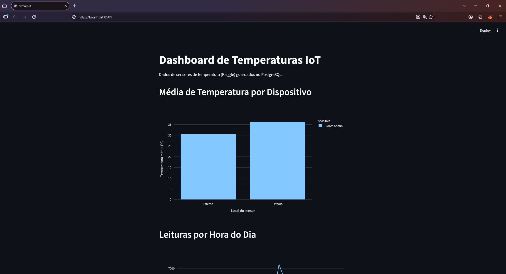
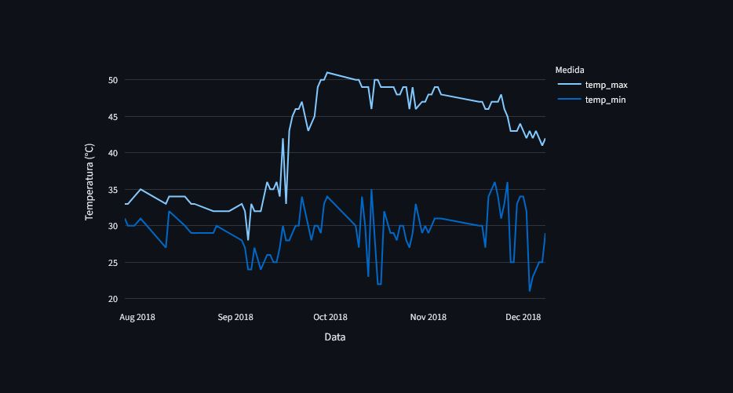
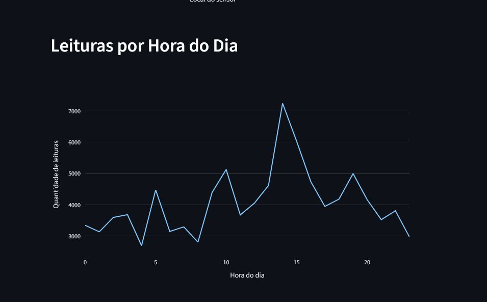

# Pipeline de Dados IoT – Leituras de Temperatura

Projeto da disciplina **Disruptive Architectures: IoT, Big Data e IA** (UniFECAF).
Autor: Lucas dos Santos Oliveira

## O que o projeto faz

Pega um CSV com leituras de temperatura de sensores IoT, trata os dados com Python (pandas),
guarda tudo num banco PostgreSQL rodando no Docker, cria 3 views SQL e mostra os resultados
num dashboard feito com Streamlit e Plotly.

## Tecnologias

- Python 3
- pandas e SQLAlchemy (tratamento e conexão com o banco)
- PostgreSQL (dentro de um contêiner Docker)
- Streamlit + Plotly (dashboard)
- Git e GitHub

## Estrutura de pastas

```
pipeline-iot/
├── data/            -> CSV do Kaggle (IOT-temp.csv)
├── docs/img/        -> prints do dashboard
├── sql/views.sql    -> as 3 views SQL
├── src/
│   ├── conexao.py       -> conexão com o PostgreSQL
│   ├── carga_dados.py   -> lê o CSV e insere no banco
│   ├── dashboard.py     -> dashboard Streamlit
│   └── resumo.py        -> números para os insights
├── docker-compose.yml
├── requirements.txt
└── .env.example
```

## Base de dados

Dataset **Temperature Readings: IoT Devices** (Kaggle):
https://www.kaggle.com/datasets/atulanandjha/temperature-readings-iot-devices

Baixe o CSV e salve como `data/IOT-temp.csv`.

## Como executar

### 1. Clonar e criar o ambiente virtual

```bash
git clone URL_DO_SEU_REPOSITORIO
cd pipeline-iot
python -m venv venv
venv\Scripts\activate        # Windows
# source venv/bin/activate   # Linux/Mac
pip install -r requirements.txt
```

### 2. Configurar a senha do banco

Copie `.env.example` para `.env` e troque a senha:

```bash
copy .env.example .env       # Windows
# cp .env.example .env       # Linux/Mac
```

### 3. Subir o PostgreSQL no Docker

Com o Docker Desktop aberto:

```bash
docker compose up -d
```

Se preferir o `docker run` (troque a senha):

```bash
docker run --name postgres-iot -e POSTGRES_PASSWORD=sua_senha -e POSTGRES_DB=iot -p 5432:5432 -d postgres
```

Para conferir: `docker ps`

> Se a porta 5432 já estiver ocupada por outro PostgreSQL instalado no PC, mude a porta
> (ex: `5433:5432`) e ajuste `POSTGRES_PORT` no `.env`.

### 4. Carregar os dados e criar as views

```bash
python src/carga_dados.py
```

### 5. Rodar o dashboard

```bash
streamlit run src/dashboard.py
```

Abre em http://localhost:8501

## Views SQL

| View | O que mostra | Para que serve |
|------|--------------|----------------|
| `avg_temp_por_dispositivo` | Temperatura média por dispositivo e por local (interno/externo) | Comparar a temperatura dentro e fora do ambiente |
| `leituras_por_hora` | Quantidade de leituras e média de temperatura por hora do dia | Ver em que horários os sensores mais registram dados |
| `temp_max_min_por_dia` | Temperatura máxima e mínima de cada dia | Achar dias com picos e acompanhar a variação diária |

## Capturas de tela





## Insights

Rode `python src/resumo.py` para ver os números e complete aqui os principais pontos
observados nos dados (diferença entre sensor interno e externo, horários de pico e dias mais quentes).

## Comandos Git utilizados

```bash
git init
git add .
git commit -m "Projeto inicial: Pipeline de Dados IoT"
git branch -M main
git remote add origin URL_DO_SEU_REPOSITORIO
git push -u origin main
git pull
```

## Observações

- O CSV tem as colunas `id`, `room_id/id`, `noted_date`, `temp` e `out/in`; no código elas foram
  renomeadas para português.
- As datas estão no formato dia-mês-ano.
- Leituras com `id` repetido são removidas antes de inserir no banco.
- A senha fica no `.env`, que não é enviado ao GitHub.
